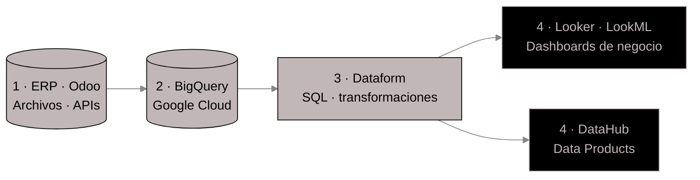

<!-- ═══════════════ CABECERA (banner amarillo c2b7b8 + barra de comandos) ═══════════════ -->
<div align="center">


<br/><br/>


<br/>


</div>

<br/>


```sql
SELECT
    'Marta Nadolna'                                 AS nombre,
    'Analytics Engineer'                            AS rol,
    'Supply Chain · Automoción'                     AS sector,
    'SQL · BigQuery · Dataform · Looker'            AS stack_diario,
    'Hacer los procesos de negocio más eficientes'  AS motivacion
FROM   vida.perfil
WHERE  datos_consistentes = TRUE
  AND  respuestas = 'rápidas · fiables · escalables';
```

Trabajo en proyectos de datos para **Supply Chain** dentro del sector de **automoción**: migración y optimización de plataformas de datos para mejorar la accesibilidad, la calidad y la fiabilidad de la información. Me muevo entre la **analítica** y la **ingeniería de datos**, construyendo soluciones que no solo respondan preguntas, sino que permitan obtener las respuestas de forma más rápida, fiable y escalable.

<br/>




<br/>


### ☁️ Cloud y Data Warehouse
<p>
  
  
  
</p>

### 🔧 Transformación y modelado
<p>
  
  
  
  
  
</p>

### 📈 BI y visualización
<p>
  
  
  
  
  
</p>

### 🐍 Lenguajes y análisis
<p>
  
  
  
  
  
  
</p>

### 🏷️ Gobierno del dato y producto
<p>
  
  
  
</p>

### ⚙️ ERP y automatización
<p>
  
  
  
  
  
</p>

### 🗣️ Idiomas


<br/>


```sql
SELECT * FROM experiencia ORDER BY inicio DESC;
```

| Periodo | Rol | Empresa | Qué hice |
|:--|:--|:--|:--|
| **Jul 2026 – Actualidad** | Analytics Engineer | **SEGULA Technologies** · proyecto Horse Powertrain | Soluciones analíticas en GCP para Supply Chain, migración de procesos con BigQuery + SQL + Dataform, dashboards en Looker, Data Products en DataHub |
| **Abr – Jul 2026** | Administrativa · Automatización y análisis | **SANE-RIEGO, S.A.** | Seguimiento de pedidos en Odoo, automatización de facturación y albaranes con IA, análisis de inventario |
| **Jun – Dic 2025** | Analista de datos | **Horse Powertrain** | Modelos predictivos de demanda, extracción automática de albaranes, Python + SQL, migración a BigQuery |
| **Mar – Abr 2025** | Analista de datos | **Turismo, Comercio y Promoción Económica de Salamanca** | Dashboards en Power BI, automatización con Power Query, Python, APIs y web scraping |

<details>
<summary><code>▶ EXPLAIN</code> &nbsp;→ SEGULA Technologies (actual)</summary>

```diff
+ Soluciones analíticas sobre Google Cloud Platform para Supply Chain
+ Migración y transformación de procesos con BigQuery, SQL y Dataform
+ Calidad y trazabilidad de los datos garantizadas
+ Dashboards en Looker adaptados a las necesidades del negocio
+ Data Products: validación de casos de negocio en DataHub
+ Documentación funcional y técnica de productos de datos
+ Requisitos funcionales traducidos a soluciones analíticas reutilizables
```
</details>

<details>
<summary><code>▶ EXPLAIN</code> &nbsp;→ Horse Powertrain</summary>

```diff
+ Modelos predictivos para anticipar la demanda y optimizar cantidades de piezas
+ Google SpaceAgent para extraer información clave de albaranes
+ Preparación e integración de grandes volúmenes de datos (ERP, archivos internos)
+ Migración y optimización de bases de datos en BigQuery
+ Mejora continua: cuellos de botella y previsión de necesidades logísticas
```
</details>

<details>
<summary><code>▶ EXPLAIN</code> &nbsp;→ Turismo de Salamanca</summary>

```diff
+ Dashboards interactivos en Power BI del perfil del turista en Salamanca
+ Gráficos mensuales automatizados con Power Query
+ Series temporales con Python (pandas, NumPy, Matplotlib, Seaborn)
+ Datos externos vía API y web scraping
+ Limpieza y preprocesado con Python, SQL y R
```
</details>

<br/>


| Título | Institución | Periodo |
|:--|:--|:--|
| Máster en Ciencia de Datos Aplicada a las Ciencias Sociales | Universidad de Salamanca | 2024 – 2025 |
| Grado en Administración y Dirección de Empresas Tecnológicas | Universidad Pontificia de Salamanca | 2022 |
| Grado en Administración y Dirección de Empresas (Gestión Inmobiliaria) | Uniwersytet Ekonomiczny w Poznaniu | 2020 – 2023 |

**Certificaciones**


<br/>


<div align="center">


</div>

<br/>


```sql
SELECT email, linkedin, github
FROM   contacto
WHERE  disponible = TRUE;   -- abierta a hablar de datos 📊
```

<div align="center">

<a href="https://www.linkedin.com/in/martanadolna">
  
</a>
<a href="mailto:martamarianadolna@gmail.com">
  
</a>
<a href="https://github.com/martana33">
  
</a>

<br/><br/>


</div>
